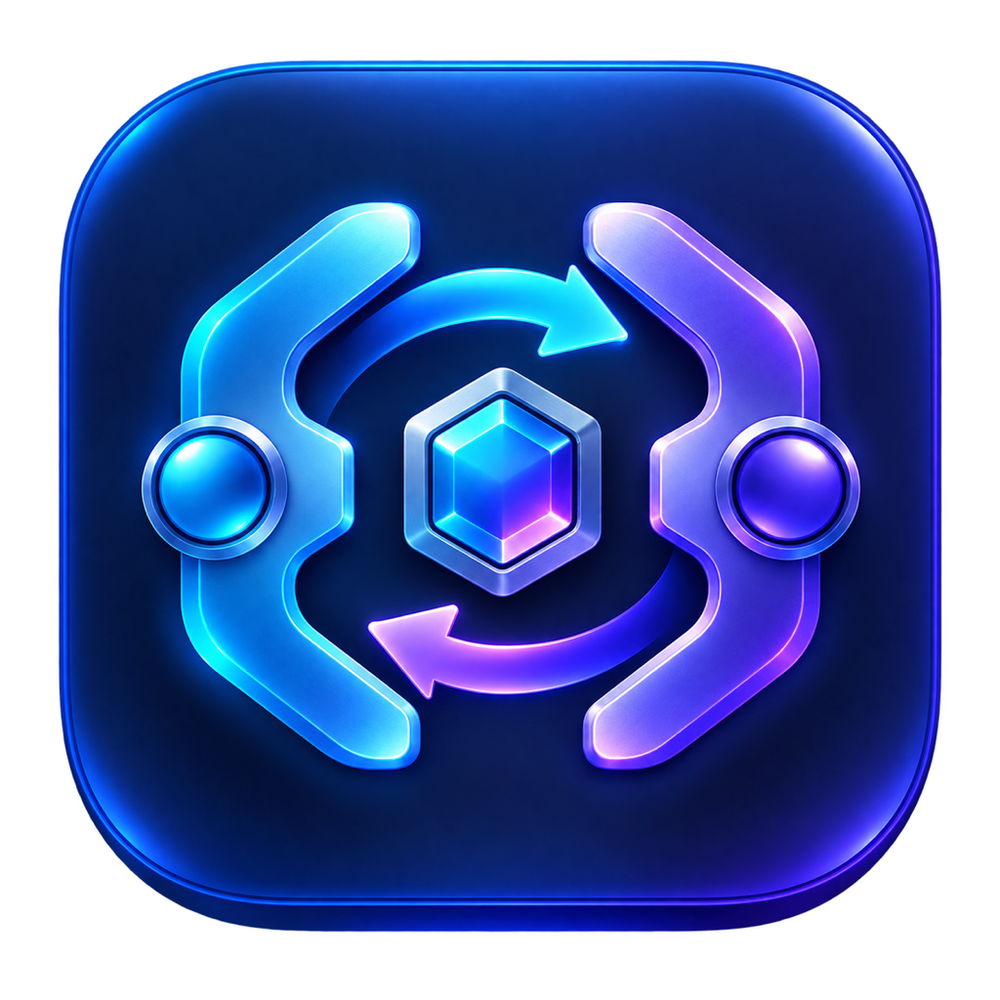

# CodexAccountBridge

The native app now includes Models and speed, Recent tasks, and CAB Worktree.
Read an explicitly selected account's official model catalog, save launch presets,
search/pin/resume stored tasks, and manage CAB-created Git worktrees. Diagnostics
inspect process account routing, and Token estimates include GPT-6.1 Sol.
See [Codex feature details](docs/CODEX_FEATURES.md) for compatibility and commands.

<p align="center">
  <strong>English</strong> · <a href="README.zh-CN.md">简体中文</a>
</p>

<p align="center">
  
</p>

CodexAccountBridge (`cab`) is an open-source Codex account manager for macOS and Linux. It provides a command-line tool and a native SwiftUI app for managing multiple official Codex or ChatGPT logins across local machines, SSH servers, remote projects, and supported agent services.

CAB keeps every login in an independent `CODEX_HOME` and delegates authentication and model traffic to the official Codex executable. It does not implement OAuth, proxy model requests, inspect token contents, or silently switch accounts after quota, authentication, or runtime errors.

## What it does

- Manage multiple official Codex logins without merging their credentials.
- Select an account explicitly for a CLI launch, the Codex desktop app, or a remote Codex app-server.
- View official Codex usage limits and reset windows for each account.
- Optionally receive local macOS notifications when a reported usage window reaches its reset time.
- Optionally start a recovered or not-yet-started usage countdown with one minimal official Codex request, with paused-refresh periods and up to three explicit daily start times.
- Manage accounts on multiple SSH servers from the native macOS app.
- Preserve or isolate project and session history during deliberate account changes.
- Opt in to cross-account session sharing with explicit disclosure and process checks.
- Bind supported Hermes and OpenClaw systemd user services to a chosen Codex account.
- Configure a visible launch rotation order without reacting to quota or errors.

## Security model

CodexAccountBridge is intentionally conservative:

- Each account receives a separate `CODEX_HOME` and signs in through official `codex login` flows.
- CAB never reads, parses, exports, or copies the contents of `auth.json`.
- The official `codex` executable is invoked directly, without a shell or argument rewriting.
- Codex approval, sandbox, and project-trust defaults remain unchanged.
- Normal usage reads are display-only. The optional usage-period wake is an explicit, opt-in minimal request and never rotates accounts because of rate limits, login failures, or runtime errors.
- Session sharing requires explicit acknowledgement and excludes credentials, `config.toml`, and account security settings. Shared rollout pointers are repaired in each account’s own SQLite index with online backups; databases are never copied between accounts.
- Configuration updates are locked, atomic, permission-restricted, and recoverable from backups.

See the [threat model](docs/THREAT_MODEL.md), [privacy notes](docs/PRIVACY.md), and [upstream safety audit](docs/UPSTREAM_AUDIT.md) for the detailed boundaries.

## Installation

### Download a release

Get ready-to-run downloads from the [latest release](https://github.com/OrangeMagician/codex-account-bridge/releases/latest). Go is only needed when building from source.

- **Mac desktop (Apple Silicon, macOS 13+)**: download `CodexAccountBridge_0.1.0_macos_arm64.dmg` and drag the app into Applications, or extract the matching `.zip`.
- **CLI (macOS / Linux)**: download `cab_0.1.0_<os>_<arch>.tar.gz`; choose `arm64` for Apple Silicon / ARM or `amd64` for Intel / AMD 64-bit. Extract it, run `mkdir -p ~/.local/bin && install -m 0755 cab ~/.local/bin/cab`, and add `~/.local/bin` to `PATH`.
- Install the official Codex CLI separately. Python 3 is also required for Token statistics and related features. Packages include `INSTALL.txt`; SHA-256 checksums accompany the downloads.

The Mac app is ad-hoc signed and has not been notarized by Apple. If macOS blocks the first launch, allow it in **System Settings → Privacy & Security**. Intel Macs can use the CLI.

### Build from source

Requirements:

- The official Codex CLI installed and available on `PATH`.
- Python 3 for the read-only Token dashboard (standard library only).
- Go 1.26.7 or newer for building the current source tree.
- macOS 13 or newer for the native desktop app.

```bash
git clone https://github.com/OrangeMagician/codex-account-bridge.git
cd codex-account-bridge
make check
make security-check
make build
install -m 0755 bin/cab ~/.local/bin/cab
```

Make sure `~/.local/bin` is on `PATH`, then initialize CAB:

```bash
cab init
cab version
```

## Manage Codex accounts

Create independent account homes and complete the official login flow:

```bash
cab account add personal
cab account add work

# Browser login on macOS or Linux desktops
cab login personal

# Device login on headless Linux servers
cab login --device-auth work

cab account list
```

Choose an account explicitly and launch the official Codex CLI:

```bash
cab use personal
cab run

cab run --account work -- exec "explain this repository"
```

The desktop management overview keeps update controls with their target: the
local “Codex desktop” card updates only this Mac, while the remote target shows
a separate server card for the selected SSH host. An update button appears
only when the version check confirms a newer release; an up-to-date
installation shows its status without an update action. The CLI commands are:

```bash
# This Mac / current CAB default account
cab update

# The remote server, after connecting over SSH
ssh your-server cab update

# Check versions without updating (useful for scripts or the desktop UI)
cab update --check --json
```

`cab update` invokes the official executable directly and never updates the
CAB shim. Codex releases installed by a method that does not support
self-update may still report that the installation method cannot be detected;
in that case use the official installer shown in the [Codex CLI guide](https://developers.openai.com/codex/cli/), then run `cab update` again to verify the resolved executable.

The remote host's CAB binary must also include the `update` and `tokens`
commands. If the remote card reports `unknown command`, update CAB on that
host and refresh the remote target; the host is running an older bridge binary.

`cab tokens --json` returns the same read-only usage data shown in the desktop
dashboard. Daily values are grouped by each thread's last activity date.

Arguments after `cab run` are passed through to the official Codex executable. Removing a CAB registration does not delete the account directory, login, or sessions.

If the default `~/.codex` directory is already signed in, register it without copying credentials:

```bash
cab account import-current current
```

CAB verifies the login through official `codex login status` and records the existing directory. It does not open or copy the credential file.

## Inspect official usage limits

CAB starts the official `codex app-server` under each selected `CODEX_HOME` and requests the account's available usage information:

```bash
cab usage
cab usage --account personal
cab usage --json
```

Depending on the official response, the report can include the ChatGPT plan type, primary and secondary Codex usage windows, reset times, credits, spend controls, and available rate-limit resets. When `rate_limits_by_limit_id` includes a Reserve/fallback bucket, the desktop client also shows its remaining percentage and reset time (for example, Luna Reserve). Account identity, email addresses, token contents, and reset credential identifiers are not exposed.

When an account reports an available rate-limit reset, the macOS app shows a Reset usage button. A bright warning sheet requires a second confirmation and calls the official Codex reset-credit method with an idempotency key. It warns when usable five-hour or weekly capacity would be replaced, then refreshes both windows after the operation. CAB selects the explicitly chosen credit and retains its opaque ID with the idempotency key while the result is uncertain.

The macOS app includes an optional usage-reset notification switch in App settings → Resets and notifications. It is off by default and requests system notification permission only when enabled. CAB replaces its scheduled notifications whenever usage data is refreshed and removes them when the switch is turned off. A notification indicates that the reported reset time has arrived; refresh CAB to confirm the latest server-side quota.

The optional **Codex global reset alerts** switch in **App settings → Resets and notifications** polls the [Did Codex Reset public API](https://didcodexreset.com/zh/api.html) anonymously every 5 minutes while CAB is running. It displays global resets and reset-credit announcements separately, using the local calendar for today. The first successful check establishes a baseline without historical notifications; subsequent completed events from the past 24 hours are deduplicated by ID across restarts. Permission is requested only when enabled. Disabling stops background alert checks; the visible overview may still fetch today's public status without sending notifications. Rate limits honor Retry-After, network failures back off, and previous data remains visible. This unofficial feed is advisory and does not confirm an account’s quota. It never triggers account switching, tasks, or reset-credit consumption. Checks stop when CAB quits.

The **Automatically use expiring reset cards** switch in **App settings → Automation** is on by default. While CAB is running, it independently checks logged-in accounts locally and on configured remote servers, and directly redeems the earliest-expiring card at a configurable time before expiry (5 minutes by default, with a minimum of 2 minutes), regardless of remaining quota, without a confirmation dialog. Checks ignore ordinary refresh intervals and paused-refresh periods. Expired cards and cards without an explicit ID or expiry are skipped. An uncertain result retains the original request and blocks further automatic redemptions for that account; retry the original card manually to reconcile it. Cards outside the configured expiry window are never selected as a fallback. If the official service reports nothing to reset, no card is consumed and CAB checks again later. Execution requires CAB to be open, the device awake, and the service reachable.

Automatic refresh is evaluated per account and continues at the configured interval even when an account reports zero remaining usage. Manual refresh still queries every account. The App settings → Automation usage-period wake switch is off by default. When enabled, CAB checks usage after a recovered period or at up to three explicit daily start times, then sends one deliberately tiny `gpt-5.6-luna` request only when the five-hour or weekly window has no active countdown. Up to three paused-refresh periods suppress ordinary automatic reads and recovery-triggered probes; explicit start times take priority. CAB verifies the returned reset window after a wake request and does not retry a failed probe automatically.

The low-level probe is also available for a deliberate manual check:

```bash
cab usage probe --account personal
```

It invokes the official Codex executable with an ephemeral, read-only temporary workspace and never persists a session or exposes the response.

Usage information never triggers an automatic account change.

## Native macOS app

CodexAccountBridge includes a native SwiftUI interface for local and remote account management:

```bash
make macos-app VERSION=0.1.0 BUILD_NUMBER=1
./scripts/package-release.sh 0.1.0
open "dist/CodexAccountBridge.app"
```

The app can:

- Switch between this Mac and saved SSH servers.
- Register, sign in, reauthenticate, and inspect independent accounts.
- Display quota summaries, Reserve/fallback model capacity, and detailed official usage periods.
- Show cumulative and daily token increments from persisted Codex `token_count` events (UTC), with
  daily, weekly, and cumulative views.
- Update the local CLI and the selected remote server's CLI with one click.
- Check remaining five-hour, weekly, and available Reserve usage from the menu bar, then launch Terminal with an explicitly selected account.
- Use standard shortcuts to refresh status (`Command-R`), refresh usage (`Shift-Command-R`), or launch Codex (`Command-Return`).
- Configure optional usage-period wake checks, daily start times, and paused-refresh periods from App settings → Automation.
- Launch the Codex desktop app with a selected local account.
- Select the account used by new remote Codex connections.
- Preserve approved projects, complete chat content and catalog state, goals, memories, personal skills, attachments, prompt history, and unsent drafts during deliberate desktop account changes.
- Manage session-sharing policy, launch rotation, and supported agent bindings.

Local desktop switching allows at least 30 seconds for a normal quit and checks the actual process state rather than relying on cached application flags. A remaining desktop instance blocks migration and relaunch; CAB never force-quits it. If the desktop finishes quitting as an error is handled, CAB attempts to reopen the original account.

If an automatic usage refresh fails, CAB keeps the last successful values visible and marks them as cached instead of replacing them with an empty state.

Saved server labels and SSH host strings remain in local macOS `UserDefaults`. SSH identity files and private-key contents are not imported into CAB.

## Remote Codex over SSH

Install CAB on the remote host, select the account used by new remote Codex app-server processes, and install the shim:

```bash
cab remote use work
cab shim install --dir ~/.local/bin --force
command -v codex
codex --version
```

`cab remote use` selects the account for new app servers. The desktop Switch remote Codex action confirms the old desktop connections to disconnect, saves and verifies the target account first, then requests a normal exit so the official client can reconnect. Active tasks may be interrupted; save work first. Completion requires actual replacement desktop processes using the target home. Reconnect and apply also repairs existing connections when the target account is already selected. Correctly routed connections, ordinary CLI sessions and independent agent bindings are preserved. Reconnected processes are never stopped in a loop or force-killed.

For the phone-to-desktop-to-Ubuntu workflow and SSH details, see [Remote setup](docs/REMOTE.md).

## Session isolation and sharing

Sessions are isolated by default. To let one account resume another account's history, stop the affected Codex processes and acknowledge the cross-account disclosure:

```bash
cab sessions enable \
  --acknowledge-cross-account-context \
  --confirm-codex-stopped

cab run --account work -- resume --last
```

Return to independent session copies with:

```bash
cab sessions disable --confirm-codex-stopped
```

CAB stops on conflicting session files instead of overwriting either side. Timestamped backups are retained for recovery.

With shared history enabled, CAB repairs existing thread indexes before account selection and before launching Codex. For duplicate rollout files with the same thread ID, the last complete event timestamp selects the newest history; all original files remain intact. CAB also retains projectless threads, pins, section membership and useful display names. Empty or working-directory titles cannot replace a useful name. Missing rows are imported only from an existing official index and a verified shared rollout, retaining that thread’s original settings; existing approval, sandbox, archive and runtime fields are never overwritten. The outgoing account supplies explicit pin/unpin and membership edits. Desktop switches additionally retain legacy pins, per-host pin order and local/remote sidebar membership. Unrelated account tables and trust settings stay untouched.

Repair already stale indexes without stopping running tasks:

```bash
cab sessions repair-index --json
```

This optional shared-index feature requires system Python 3.9+ with its standard-library `sqlite3` module (`/usr/bin/python3` or `/bin/python3`). This narrowly scoped system-tool dependency provides WAL-aware online backups and transactional updates without third-party packages or Go dependencies. Backups are retained under CAB's data directory as `index-backup-*`; failures block account selection or launch rather than bypassing repair. Do not resume the same task concurrently in two accounts.


## Optional launch rotation

Rotation is disabled by default. When enabled, it only selects the next account before a new `cab run` without an explicit `--account`:

```bash
cab rotation configure --accounts personal,work
cab rotation enable
cab rotation status

cab run
cab run

cab rotation disable
```

Explicit account selection always wins. Rotation does not inspect usage and does not retry failed work with a different login.

## Supported agent bindings

On Linux servers, CAB can discover supported Hermes gateway/bridge and OpenClaw gateway systemd user services. Bindings are explicit and independent from the remote Codex selection:

```bash
cab agent list
cab agent bind --service hermes-gateway-coder.service --account work --confirm-restart-agent
cab agent bind-all --account work --confirm-restart-agent
cab agent unbind --service hermes-gateway-coder.service --confirm-restart-agent
```

CAB writes a managed `CODEX_HOME` systemd drop-in. It does not copy credentials. Active services are restarted only after explicit confirmation; inactive services are not started automatically.

## Diagnostics

```bash
cab doctor

# Only when doctor reports an interrupted session migration
cab doctor --repair
```

Diagnostics inspect executable availability, directories, symlinks, transaction state, and permissions. They do not inspect token contents or conversation text.

## Configuration paths

- Configuration: `${XDG_CONFIG_HOME:-~/.config}/codex-account-bridge/config.json`
- Account data: `${XDG_DATA_HOME:-~/.local/share}/codex-account-bridge/`
- Portable/test overrides: `CAB_CONFIG_HOME` and `CAB_DATA_HOME`
- Official executable override: `CAB_REAL_CODEX=/absolute/path/to/codex`

## Non-goals

- Automatic switching based on quota, rate limits, authentication failures, or runtime errors.
- A third-party OpenAI-compatible API proxy.
- Custom OAuth, token import/export, or a browser-based token dashboard.
- Real-time replication of Codex internal databases between machines.
- Changing Codex approval, sandbox, or project-trust behavior.

## Development

```bash
make check
make security-check
make release VERSION=0.1.0
make macos-app VERSION=0.1.0 BUILD_NUMBER=1
./scripts/package-release.sh 0.1.0
```

This repository does not use GitHub Actions. Release binaries and SHA-256 files are built and verified locally by the maintainer.

## License

Apache License 2.0. Codex and ChatGPT are trademarks of their respective owners. This project is not affiliated with or endorsed by OpenAI.

### Token activity

The overview also shows today, month and total **estimated API equivalent (USD)** at the bundled standard short-context rates. Unknown models stay unpriced; this is not an account balance or actual bill. Expand the model breakdown for scope and rate details. See [estimation methodology](docs/COST_ESTIMATES.md).

Use `cab tokens --json` (optionally `--account NAME`) or the macOS overview to inspect recorded token usage. Python 3 is required (standard library only). The read-only index locates session token events; daily usage is attributed to the actual UTC event date, not the thread's last update. Repeated snapshots and shared histories are deduplicated. Totals include cached input; the dashboard separates uncached input, cached input, and output (including reasoning). Missing or incomplete histories are disclosed. The yearly activity grid fits the available width and exposes date, exact tokens, and session count on hover or selection.

## Diagnostics, backups, and project launches

The macOS sidebar now provides **Diagnostics & backups**, **Project launcher**, and
**Switch history**. Diagnostics show CAB/Codex versions, the resolved executable,
PATH entry, account routing, Python/SQLite availability, and running Codex processes.
The desktop checks remote CAB capabilities before using maintenance features; older
servers receive an update message instead of an unsupported operation.

```bash
cab capabilities
cab doctor --json
cab backups list --json
cab backups preview --id BACKUP_ID --action restore --json
# Only after quitting Codex and reviewing the preview:
cab backups restore --id BACKUP_ID --confirm --confirm-codex-stopped --json
cab backups preview --id BACKUP_ID --action delete --json
cab backups delete --id BACKUP_ID --confirm --json
cab run --account work --directory /absolute/project/path
```

Backup IDs are derived from the listed file's identity metadata; arbitrary input
paths are not accepted. Only recognized CAB backups under registered account homes
and uniquely attributable index backups are listed. Symlinks, special files, and
credential filenames are rejected before content access. Restoring requires Codex
to be stopped, obtains an exclusive CAB session lease, and backs up the current
target first. SQLite restore uses the online backup API, including current WAL
contents in the rollback backup. Shared session links must be disabled before
restoring independent session directories. Deletion is permanent and applies only
to the explicitly previewed backup. There is no automatic cleanup.

Project launch profiles are saved on this Mac and always specify an account, target,
and absolute directory. Launching revalidates the account and remote capability;
it preserves official approval, sandbox, and project-trust settings. Switch history
retains at most 200 operations with stage results and backup locations. An interrupted
CAB operation is shown as needing verification; history never stores raw command
output, conversation content, or credentials.

**Low quota alerts** in Settings are off by default. Choose a remaining-quota threshold,
5-hour/weekly windows, and optional quiet hours in this Mac's time zone. Each account
and quota cycle alerts once; stale or failed reports are ignored. Quiet periods defer
evaluation until the next successful refresh. Alerts never launch requests or switch
accounts. Notification permission is requested only when enabling the feature.

Window and menu-bar quota requests share an in-flight registry and short-lived cache,
with at most four concurrent account reads. Manual refresh bypasses completed cache
entries. Failed account refreshes keep the last successful values and timestamp.
Read-only operations can be cancelled; SSH uses bounded connection/keepalive timeouts.
A timeout does not prove a remote mutation was rolled back: refresh to verify its result.

Token statistics cache only normalized event timestamps, model IDs and numerical counters in
`$CAB_DATA_HOME/token-cache-v1.sqlite` (the default CAB data directory otherwise).
Unchanged files reuse cached events; appended files resume at a validated byte boundary.
Truncated, replaced, or rewritten files are rescanned. Shared history remains deduplicated
on every aggregation, and incomplete final lines are retried on the next refresh.
The cache contains no conversation text and can be removed while CAB is idle to force
reconstruction. `scanned_bytes` in `cab tokens --json` reports newly scanned event bytes.

Preferences are grouped in the main window under **App settings**: general and display, quota refresh, resets and notifications, automation, and accounts and sessions. The overview highlights today's reset status and the alert switch; source details remain in settings. Command+, opens this main-window page instead of a separate settings window.
